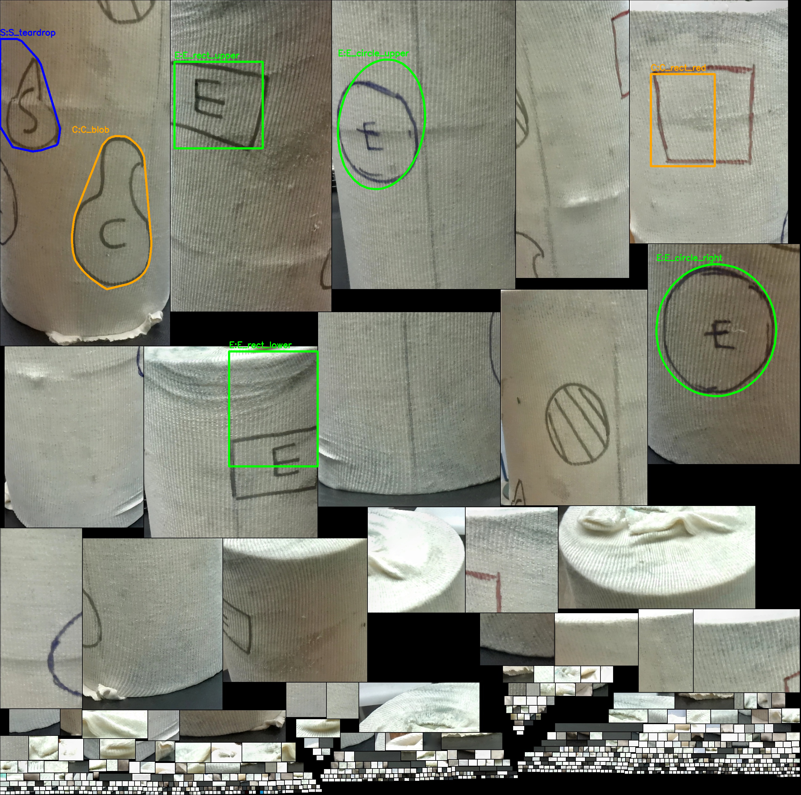
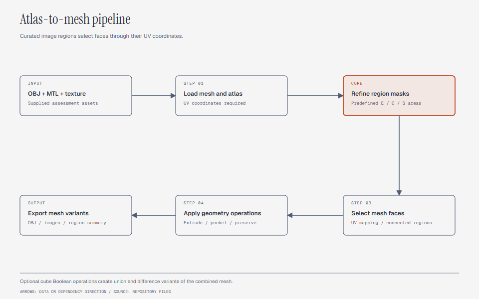

# RiseBionics AutoMesh

A Python mesh-processing application for an OBJ model with a texture atlas. It maps marked atlas regions to mesh faces and exports geometry variants.



## Processing pipeline



The pipeline loads OBJ geometry, UV coordinates, and its texture. Curated regions identify the expected markings in the supplied assessment atlas.
Image processing refines those regions before UV coordinates select mesh faces.

| Label | Operation |
|---|---|
| E | Extrude the selected region |
| C | Create an inward pocket |
| S | Preserve the original geometry |

The code uses predefined regions for this assessment image. It does not implement a general trained model or unrestricted letter recognition.

## Run

Use Python 3.10 or later. Keep the OBJ, MTL, and texture image together.

```sh
python -m venv .venv
# Activate the environment before the next command.
python -m pip install -r requirements.txt
python main.py
```

`main.py` starts the Tkinter interface. The interface contains file selection, atlas previews, operation controls, and a mesh viewer.

For the alternate viewer in `mainv2.py`, install its optional PyVista dependency:

```sh
python -m pip install pyvista
python mainv2.py
```

A pipeline run without the GUI uses:

```sh
python main.py EngineeringMLAssessment.obj --no-gui --out assessment_output
```

Both versions expose `--out`, `--cube`, `--no-gui`, and `--skip-booleans`.
The current headless path calls `run()` directly. It does not pass `--cube` or `--skip-booleans` into that function.

## Results

| Output | Meaning |
|---|---|
| `00_original.obj` | Loaded source mesh |
| `01_edge_detection_mask.png` | Detected atlas ink |
| `02_flattened_shapes_labeled.png` | Regions and labels |
| `03_E_extruded.obj` | Extrusion result |
| `04_C_pocketed.obj` | Pocket result |
| `05_S_original.obj` | Preserved geometry generated by the CLI path |
| `06_ECS_combined.obj` | Combined E and C operations |
| `07_union_*.obj` | Cube unions at three positions |
| `08_sub_*.obj` | Cube differences at three positions |
| `detected_shapes.json` | Generated region and face counts |

The checked-in `output/` directory contains saved examples, not every file listed above.
See the [walkthrough video](Risbionics_app_gothrough.mp4) for the recorded interface.

## Repository map

- [main.py](main.py): processing code and the initial desktop interface.
- [mainv2.py](mainv2.py): alternate atlas refinement and PyVista-based viewer.
- [requirements.txt](requirements.txt): shared numerical, image, and mesh dependencies.
- `EngineeringMLAssessment.obj`, `.mtl`, and `.jpg`: supplied source assets.
- [output](output/): saved mesh variants and image artifacts.
- [README_SUBMISSION.md](README_SUBMISSION.md): earlier submission notes.

## Limits

The region coordinates assume the supplied texture layout. Different atlases need new region definitions.
Boolean operations attempt the Manifold engine and include fallback behavior. Inspect outputs for watertightness and intended geometry.
The application does not establish suitability for clinical use or physical manufacture.
This documentation update adds no new mesh-processing or hardware validation results.

## License

[MIT](LICENSE) covers original software and documentation by Velan E.
The supplied assessment model, textures, logo, and derivative assets have separate provenance.
See [LICENSING.md](LICENSING.md) before redistributing those assets.
